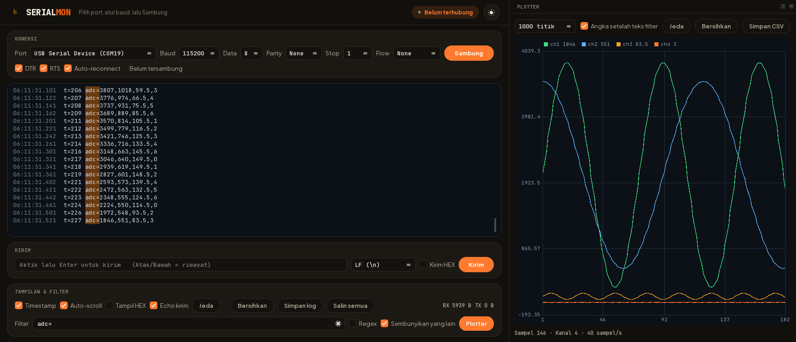
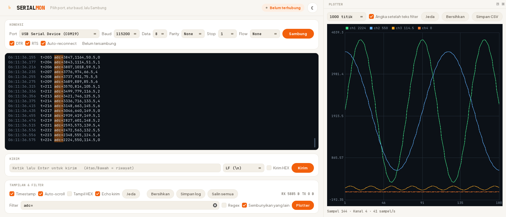

# SerialMon

Serial monitor untuk Windows (C++ / Qt 6) — pengganti PuTTY / Serial Monitor Arduino: tinggal pilih port, atur baud, sambung.



<details>
<summary>Tema terang</summary>



</details>

## Fitur

- **Port picker**: dropdown dengan nama seperti di Device Manager (mis. `USB-SERIAL CH340 (COM7)`), daftar otomatis diperbarui saat kabel dicolok/dicabut
- **Baud bebas** (preset 9600 – 3 Mbaud, atau ketik sendiri), data bits, parity, stop bits, flow control (RTS/CTS, XON/XOFF)
- **DTR / RTS** bisa diatur langsung (untuk reset dan boot mode ESP32/Arduino)
- **Auto-reconnect** saat board di-reset atau kabel dicabut lalu dicolok
- **Terminal**: timestamp milidetik, tampilan HEX, error/warning berwarna, warna ANSI dibuang, auto-scroll yang mati sendiri saat scroll ke atas, jeda, simpan/salin log
- **Kirim**: teks atau HEX, akhiran LF/CRLF/CR/tanpa, echo, riwayat (↑/↓)
- **Filter + highlight**: tampilkan hanya baris yang mengandung teks (atau regex), teks yang cocok di-highlight
- **Plotter real-time**: angka dari baris yang cocok filter dipecah jadi kanal grafik. Contoh baris `adc=123.1,123,455,333.2,1` → 5 kanal. Ada jendela titik, hover untuk nilai, klik legenda untuk sembunyikan kanal, penghitung sampel, ekspor CSV
- **Tema terang / gelap** bergaya [mbektiw.my.id](https://mbektiw.my.id)

Backend serial memakai Win32 API langsung (tanpa QtSerialPort), jadi tidak ada dependensi selain Qt Widgets.

## Pakai

Unduh dari halaman [Releases](../../releases):

- **`SerialMon-v1.0.0-portable.exe`** - satu file, klik dua kali. Pertama dijalankan mengekstrak diri ke `%LOCALAPPDATA%\SerialMon` (beberapa detik), setelah itu langsung terbuka.
- `SerialMon-v1.0.0-win64.zip` - versi folder: ekstrak, jalankan `SerialMonitor.exe`.

Keduanya tanpa instalasi. Exe satu file butuh Windows 10/11 (memakai `tar.exe` bawaan); sebagian antivirus bisa curiga pada exe yang mengekstrak diri, pakai zip jika terjadi.

Contoh plotter: pilih port, Sambung, isi filter `adc=`, klik **Plotter**. Centang "Angka setelah teks filter" agar angka sebelum kata filter (mis. `t=208`) tidak ikut jadi kanal.

Coba tanpa hardware: `SerialMonitor.exe --demo`

Opsi lain: `--theme=light|dark` (paksa tema), `--shot=file.png` (simpan tangkapan jendela lalu keluar).

## Build

Butuh Qt 6 (MSVC 2022 64-bit), Visual Studio dengan workload C++, CMake dan Ninja.

```bat
set QT_DIR=C:\Qt\6.11.1\msvc2022_64
build.bat       :: hasil: build\SerialMonitor.exe
package.bat     :: hasil: dist\SerialMon-v1.0.0-win64.zip (exe + DLL Qt)
```

`vcvars64.bat` dicari otomatis lewat `vswhere`; bisa dioverride dengan variabel `VCVARS`.

## Lisensi

MIT — lihat [LICENSE](LICENSE). Font Plus Jakarta Sans dan JetBrains Mono (di `assets/fonts`) berlisensi SIL OFL 1.1. Qt dipakai di bawah LGPLv3 (DLL disertakan di zip rilis).
